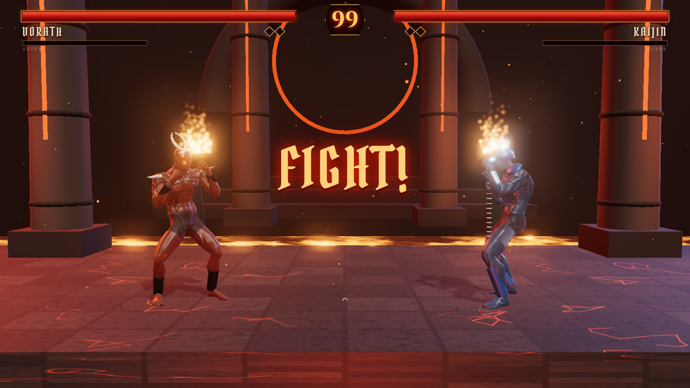

# BLOODRITE — Rites of Damnation

A gothic 2.5D fighting game that runs in the browser. It is built with Three.js, and you can play it against the CPU, against a friend on the same machine, or online peer-to-peer.

**▶ Play: https://xdi8blox.github.io/bloodrite/**



## Features
- **4 fighters:** VORATH (lava demon), KAIJIN (ice revenant with a chain), NYXARA (blood witch) and MORGRIM (grave lord).
  - Each has 3 specials (projectiles, pulls, rushes, slides, teleports and pillars), a meter-based **super** and a unique finisher.
- **3 arenas:** Infernal Temple, Frozen Ossuary and Profane Cathedral.
- **Combat:**
  - Jab/cross/hook strings, launchers and juggles with damage scaling.
  - Crouching, sweeps, air attacks, blocking, throws and chip damage.
- **Match presentation:**
  - Best of 3 rounds with an announcer, hit-stop, slow-motion KOs, streak sparks and blood decals.
  - **CONDEMN THEM!** prompt, then the **DAMNATION** finisher with a cinematic camera.
- **Modes:**
  - vs CPU (Easy, Normal, Hard, Nightmare).
  - Local 2-player on a split keyboard or gamepads.
  - **Online 1v1** via a room link, using WebRTC (PeerJS) with rollback netcode.
  - Practice mode with a move list.
- **Options:** volume, graphics quality (low/medium/high), difficulty and announcer voice. Mobile gets touch controls and a landscape prompt.
- **Audio:** fully procedural (WebAudio).

## Controls
| | Player 1 | Player 2 |
|---|---|---|
| Move / jump / crouch | W A S D | Arrow keys |
| Punch | J | Numpad 1 / N |
| Kick | K | Numpad 2 / M |
| Block | L | Numpad 3 / , |
| Throw | I | Numpad 4 / . |
| Super / Finisher | O | Numpad 5 / / |

Gamepads (standard layout): X/Square punch, A/Cross kick, LB/RB block, Y/Triangle throw, LT/RT super, d-pad/left stick move, Start pauses. Keyboard: Esc or P pauses.

**Motions** (written for a fighter facing right):
- ↓↘→ + P
- ←→ + K
- ↓↓ + P

Each fighter's moves are in **Move List**.

**Finisher:** win the deciding round. When **CONDEMN THEM!** appears, get close and press **Super**.

## Online
1. Choose Online, pick a fighter, then Create Room and pick an arena.
2. Send the link (`…?room=CODE`) to your opponent.

Netcode details:
- Rollback-lite with 2 frames of input delay and up to 8 predicted frames.
- Redundant input packets and periodic desync hashes.
- Heartbeat with a 5 s timeout, so disconnects are handled gracefully.
- Signaling uses the free public PeerJS broker. Some strict NATs may fail to connect because no TURN server is used.

## Development
```bash
npm install
npm run dev          # http://127.0.0.1:4400
npm run build        # type-check + production build into dist/
node tools/build-assets.mjs   # re-encode raw Quaternius files from assets-src/ (not committed)
node tools/shots.mjs          # regenerate screenshots (dev server must be running)
node tools/online-test.mjs    # two headless pages play an online match and compare state hashes
node tools/ui-test.mjs [url] [touch|mouse|both]  # tap-only (iPhone landscape) + mouse-only title→menu→select→arena→fight, all modes
```

## Credits
- Characters and animations by **Quaternius** (CC0).
- Fonts: Pirata One and Cinzel (OFL).

Full list in [ASSETS.md](ASSETS.md).

Code is released under the [MIT](LICENSE) license.
